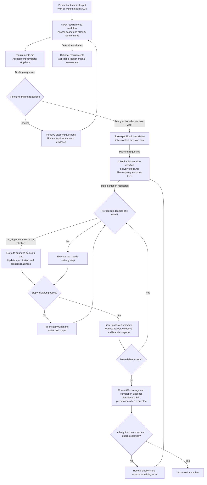

<!-- START doctoc generated TOC please keep comment here to allow auto update -->
<!-- DON'T EDIT THIS SECTION, INSTEAD RE-RUN doctoc TO UPDATE -->

- [Ticket Lifecycle](#ticket-lifecycle)

<!-- END doctoc generated TOC please keep comment here to allow auto update -->

# Ticket Lifecycle

Each skill stops at its own output. The next stage runs only when requested and may resume in a
later session from the saved artifact. All ticket artifacts share the resolved `<ticket-dir>`;
filenames below omit the `<ticket>-` prefix for readability. This diagram summarizes the
[canonical workflows](../consumer.md#workflow-catalog); it does not add requirements to them.

Bounded decision work requires a safe investigation scope, responsible role, expected evidence,
acceptance condition, and blocked dependencies. Unresolved security or personal-data safeguards
cannot be treated as optional work. A scope or contract change returns to requirements and
specification reconciliation before dependent implementation resumes.

An existing implementation-ready ticket can enter at planning without a retrospective requirements
assessment. Review reports findings; authorized implementation resolves them. Completion requires
the ticket's applicable outcomes and evidence, including any required CI, manual, or operational
checks. Commits, pushes, publication, merge, and remote issue closure remain separately authorized
actions; this diagram does not trigger them.

For issue-based work, [GitHub ticket synchronization](../rules/spec-first-rules.md#github-ticket-synchronization)
also gates planning, implementation/resume, and completion. Every local specification edit
triggers preparation of a GitHub update with explicit permission; local review checks the match
without repairing drift. Ad hoc tickets are exempt.
